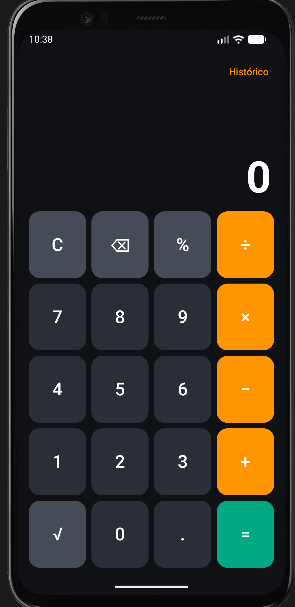
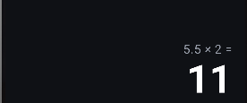
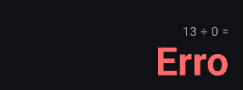
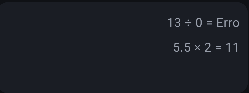
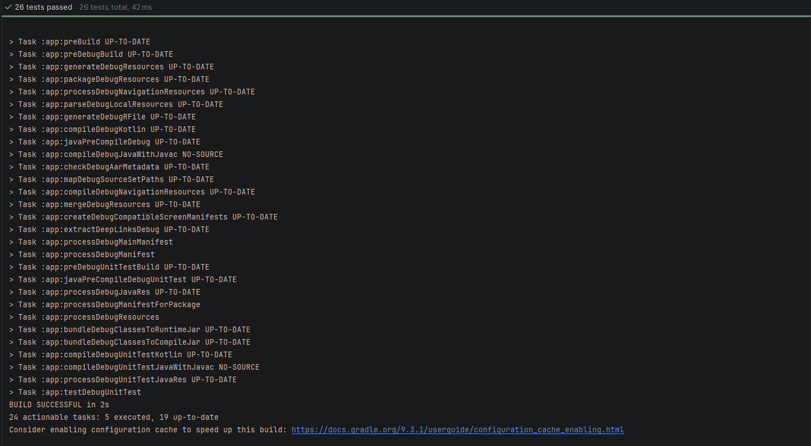

#Calculadora (Kotlin + Jetpack Compose)

**Projeto PDM** — Matheus Borges e Henrique Gouveia — 3H

## Objetivo

Calculadora para Android com a lógica matemática em Kotlin e a interface
construída com Jetpack Compose. Trabalha com números inteiros e decimais.

## Funcionalidades

| Funcionalidade | Como funciona |
|---|---|
| Adição, subtração, multiplicação e divisão | Teclas `+`, `−`, `×`, `÷` |
| Visor | Mostra o que está sendo digitado e o resultado; uma linha menor mostra a última conta (`2 + 3 =`) |
| Limpar | Tecla `C` zera a conta |
| Corrigir número digitado errado | Tecla `⌫` apaga o último dígito (ou o operador, se o 2º número ainda não foi digitado) |
| Números decimais | Tecla `.` (um ponto por número; `.5` vira `0.5`) |
| Divisão por zero | O visor mostra `Erro` em vermelho; digitar um número ou `C` recomeça |
| Porcentagem (extra) | `%` — `50%` vira `0.5`; em `200 + 10%` o valor vira 10% de 200 |
| Raiz quadrada (extra) | `√` — raiz de número negativo mostra `Erro` |
| Histórico de cálculos (extra) | Botão `Histórico` abre o painel (mais recentes primeiro) e `Limpar histórico` |
| Encadeamento | `2 + 3 +` já calcula `5` e continua |
| Rotação de tela | A conta e o histórico são preservados (`rememberSaveable`) |

Cuidados extras: limite de 15 dígitos, zeros à esquerda ignorados e cálculos
com `BigDecimal` (`0.1 + 0.2 = 0.3`, sem erro de ponto flutuante).

## Arquitetura

O app é dividido em duas camadas. A interface só **mostra** o estado e avisa
quando o usuário toca em algo; todas as **regras** ficam na camada de lógica.

```
app/src/main/java/com/example/projeto/
├── MainActivity.kt                 # Ponto de entrada: tema + tela
├── model/                          # LÓGICA (Kotlin puro, sem Android)
│   ├── EstadoCalculadora.kt        # Operacao (enum) + EstadoCalculadora (dados da conta)
│   └── Calculadora.kt              # Regras: digitar, operar, apagar, %, raiz, histórico
└── ui/                             # INTERFACE (Jetpack Compose)
    ├── CalculadoraScreen.kt        # Tela: guarda o estado com rememberSaveable
    ├── components/
    │   ├── Visor.kt                # Mostra a conta e o resultado
    │   ├── Teclado.kt              # Tecla (enum), Teclado e BotaoCalculadora
    │   └── Historico.kt            # BarraHistorico e PainelHistorico (LazyColumn)
    └── theme/
        ├── Color.kt                # Todas as cores
        ├── Theme.kt                # ProjetoTheme (esquema de cores escuro)
        └── Type.kt                 # Tipografia (gerado pelo Android Studio)

app/src/test/java/com/example/projeto/model/
└── CalculadoraTest.kt              # Testes unitários da lógica
```

### Fluxo de um clique

```
toque na tecla -> Teclado (onTecla) -> CalculadoraScreen.processarTecla
   -> Calculadora.xxx(estado) devolve NOVO estado -> a tela é redesenhada
```

### Decisões de projeto

- **Estado imutável:** `EstadoCalculadora` é uma `data class`; cada tecla gera um novo estado com `copy`.
- **Estado elevado (state hoisting):** só `CalculadoraScreen` guarda estado. `Visor`, `Teclado` e `Historico` recebem dados e funções (`onTecla`, `onAlternar`...).
- **Sem repetição:** o teclado é desenhado por um laço sobre a lista de `Tecla`; um único `BotaoCalculadora` serve para os 20 botões.
- **Lógica testável:** `Calculadora` não usa Android, então os testes rodam direto no computador.

## Como executar

1. Abra a pasta do projeto no **Android Studio** (projeto *Empty Activity*, com Compose).
2. Aguarde o *Gradle Sync*.
3. Escolha um emulador ou celular e clique em **Run ▶**.

As funções `@Preview` (`CalculadoraScreenPreview`, `VisorPreview`, `TecladoPreview`,
`PainelHistoricoPreview`) permitem ver a interface sem abrir o emulador.

## Como executar os testes

No Android Studio: botão direito em `CalculadoraTest` → **Run**. Pelo terminal:

```
./gradlew test
```

## Testes manuais no aplicativo

| Entrada | Resultado esperado | OK? |
|---|---|---|
| `2 + 3 =` | `5` | ☐ |
| `0.1 + 0.2 =` | `0.3` | ☐ |
| `10 ÷ 4 =` | `2.5` | ☐ |
| `8 ÷ 0 =` | `Erro` (digitar um número recomeça) | ☐ |
| `123 ⌫` | `12` | ☐ |
| `200 + 10 % =` | `220` | ☐ |
| `9 √` | `3` | ☐ |
| `3 − 5 = √` | `Erro` | ☐ |
| Girar a tela no meio de uma conta | A conta continua na tela | ☐ |


## Evidências

### Tela inicial


### Operação com decimais


### Divisão por zero (Erro)


### Histórico aberto


### Testes unitários passando

